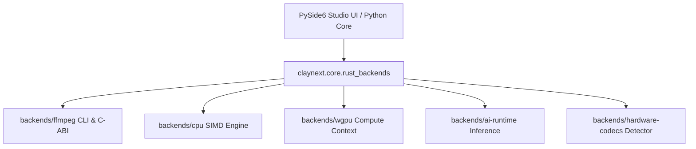

# Claynext Studio — Rust Backend Architecture

## 1. System Overview

Claynext Studio employs a hybrid desktop architecture:
- **Presentation & Timeline UI**: Python 3.12+ with PySide6 (Qt 6.11+) and cyber dark design tokens.
- **Computation & Processing Core**: Native Rust workspace in `backends/` with zero-copy interfaces and dedicated background workers.

---

## 2. Backend Workspace Crates

| Crate | Directory | Purpose | Primary Technologies |
| :--- | :--- | :--- | :--- |
| `claynext-ffmpeg` | `backends/ffmpeg/` | Media probing, decoding, transcoding, stream copy, muxing | FFmpeg 9.0 CLI, FFprobe JSON |
| `claynext-cpu` | `backends/cpu/` | Audio resampling, track mixing, waveform extraction, threadpool | Rayon, SIMD routines |
| `claynext-wgpu` | `backends/wgpu/` | Real-time timeline rendering, compositing, color grade shaders | WGPU, WGSL compute shaders |
| `claynext-ai-runtime` | `backends/ai-runtime/` | VAD chunking, ASR/TTS configs, model cache management | DirectML / ONNX Runtime |
| `claynext-hardware-codecs`| `backends/hardware-codecs/` | GPU vendor detection, NVENC, QSV, AMF, MediaFoundation | Windows CIM / D3D11 / FFmpeg NVENC |
